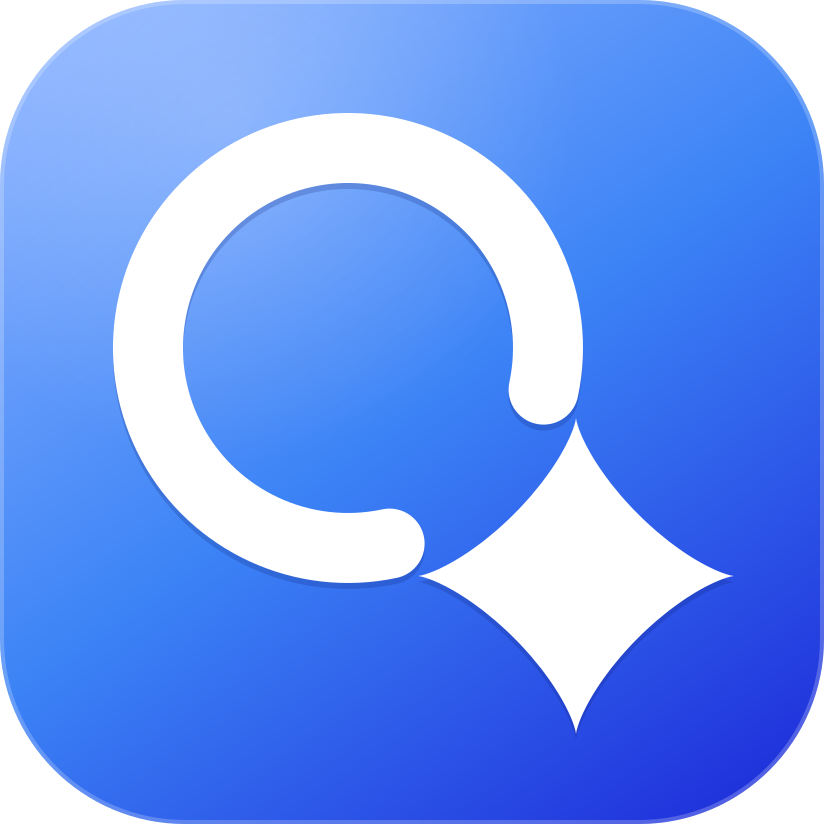
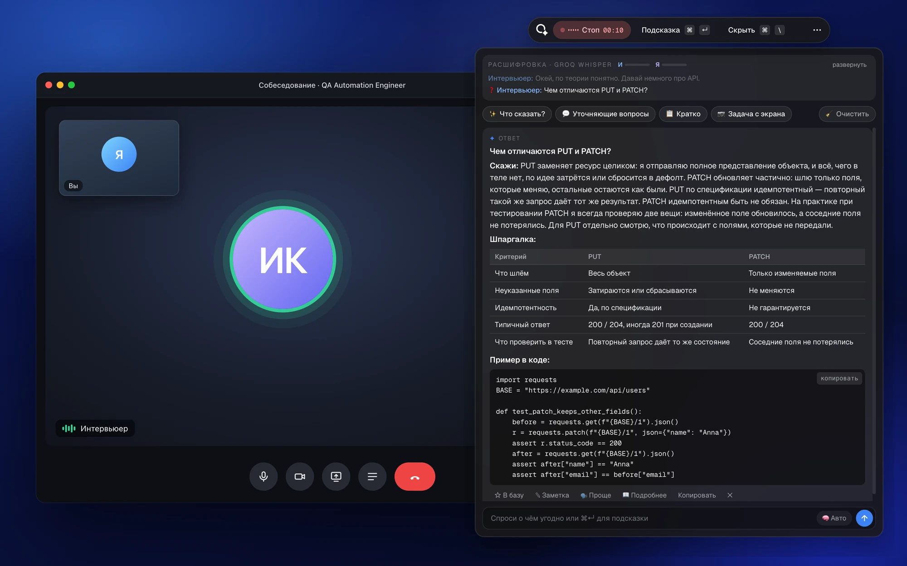
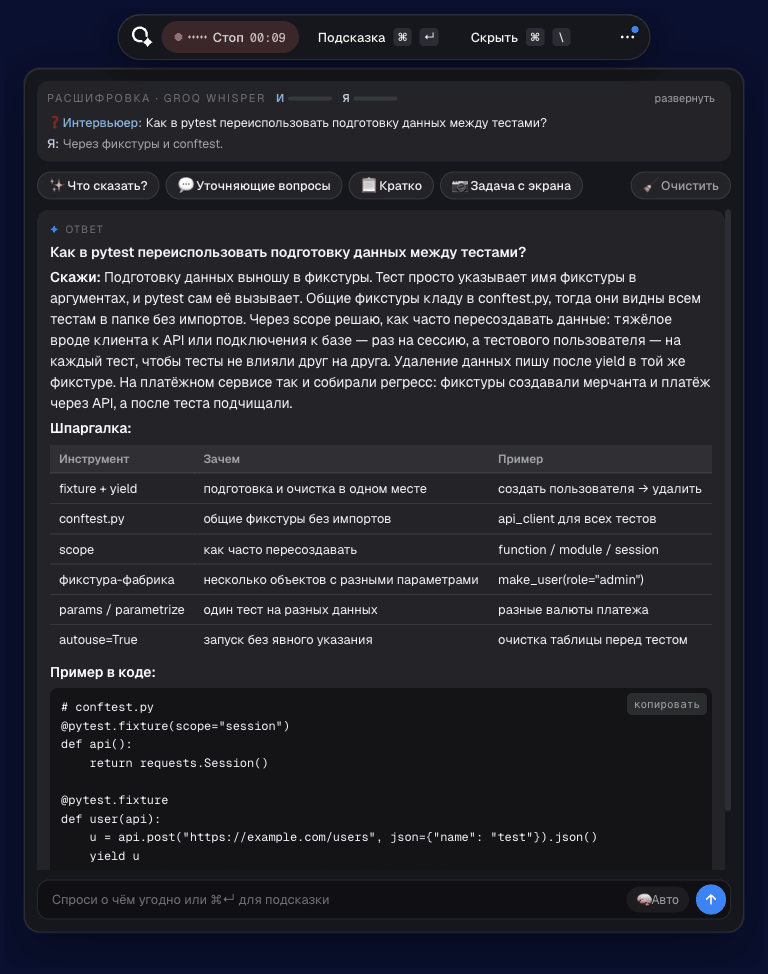
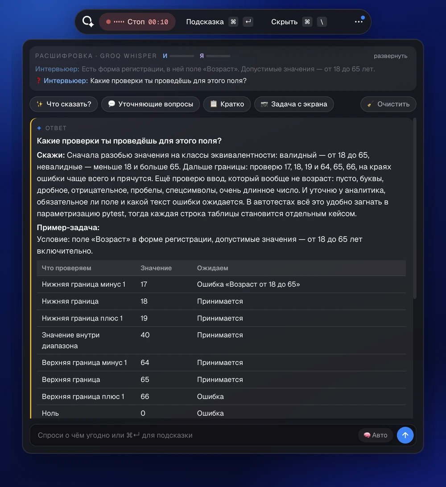
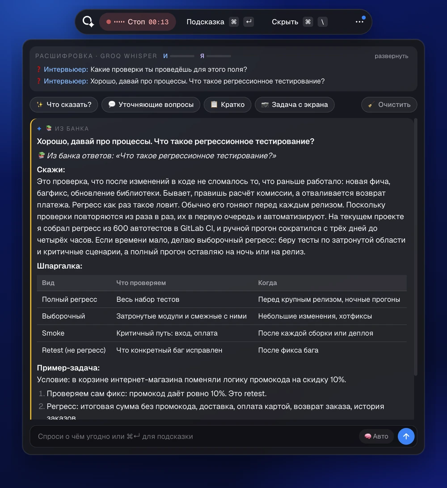
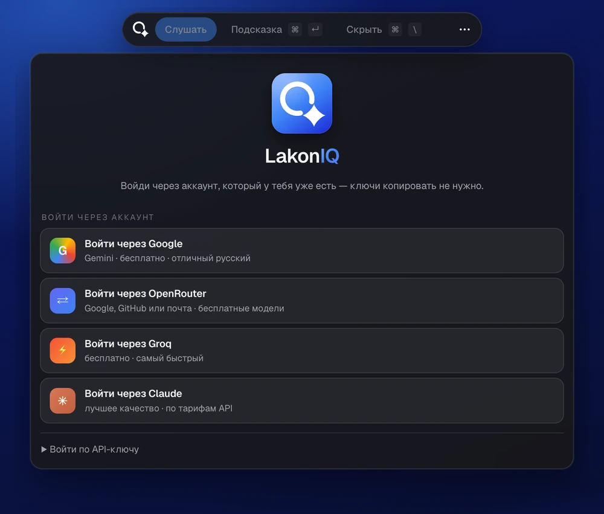
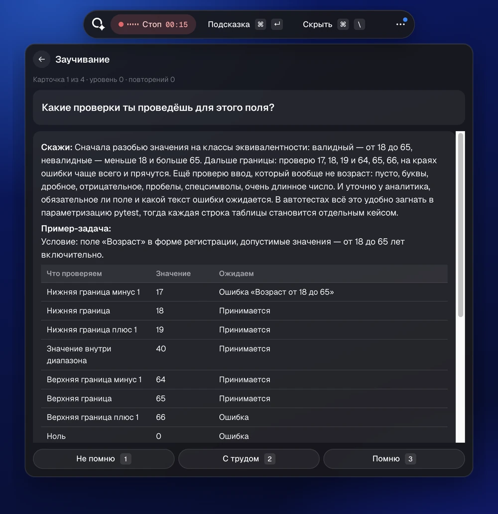
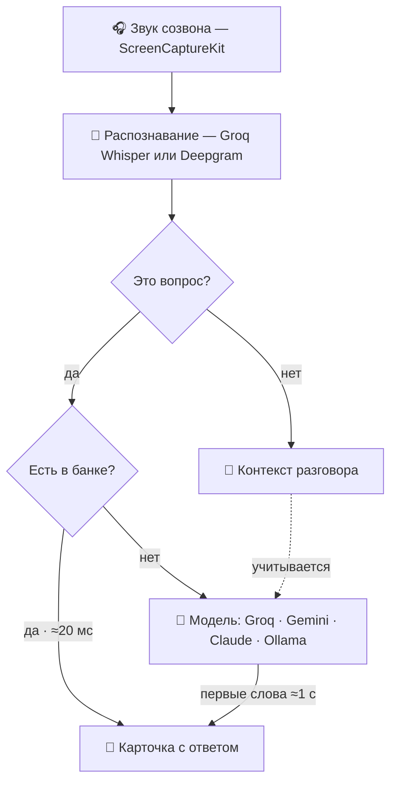

<div align="center">



# LakonIQ

**Подсказчик для собеседований на macOS.**<br>
Слышит вопрос интервьюера — и через секунду показывает, что ответить.

[](#install)
[](#install)
[](#install)
[](LICENSE)
[](#install)

[**Установить**](#install) · [Возможности](#features) · [Как это работает](#how) · [Вопросы и ответы](#faq)



</div>

<table>
<tr>
<td align="center" width="25%"><b>⚡ ~1 секунда</b><br><sub>от вопроса до первых слов ответа</sub></td>
<td align="center" width="25%"><b>🎁 Бесплатно</b><br><sub>Groq, Gemini, OpenRouter — без подписки</sub></td>
<td align="center" width="25%"><b>📚 443 вопроса QA</b><br><sub>из банка ответ появляется мгновенно</sub></td>
<td align="center" width="25%"><b>🔒 Всё у тебя</b><br><sub>данные на твоём Mac, открытый код</sub></td>
</tr>
</table>

## Как это выглядит

<div align="center">

<br>
<sub>Запись в реальном времени: вопрос из банка — ответ сразу, новый вопрос — первые слова через ~1 с.<br>Ответы — настоящие ответы Claude в режиме «Авто», резюме в демо вымышленное.</sub>
</div>

Надень наушники, открой созвон и нажми «Слушать» (<kbd>⌘</kbd><kbd>⇧</kbd><kbd>L</kbd>). LakonIQ слышит звук созвона,
отличает вопросы от болтовни и сразу пишет ответ: сначала **«Скажи»** — что произнести вслух своими словами,
потом шпаргалку, пример задачи или код — в зависимости от вопроса. Все пары «вопрос → ответ» можно отметить ★
и потом повторить в режиме заучивания.

<a id="features"></a>
## ✨ Возможности

<table>
<tr>
<td width="50%" valign="top">

<p><b>Ответ под тип вопроса.</b> Тест-дизайн — таблица проверок без лишнего кода; API, SQL, автотесты — пример в коде; теория — короткая задача; уточнение — 1–3 фразы.</p>
</td>
<td width="50%" valign="top">

<p><b>Банк из 443 вопросов QA.</b> Если интервьюер спросил вопрос из банка, ответ появляется мгновенно (≈20 мс), без запроса к ИИ. «✨ Свежий ответ» — спросить модель заново.</p>
</td>
</tr>
<tr>
<td width="50%" valign="top">

<p><b>Вход за минуту.</b> Google, OpenRouter, Groq или Claude — открывается страница сервиса, ключ подхватывается сам. Можно и по API-ключу, и локально через Ollama.</p>
</td>
<td width="50%" valign="top">

<p><b>Заучивание.</b> Отмеченные ★ ответы возвращаются карточками по системе Лейтнера — к следующему собеседованию они уже в голове.</p>
</td>
</tr>
</table>

**Слушает и понимает**
- Звук созвона берёт прямо из системы (ScreenCaptureKit) — работает с любыми наушниками, без BlackHole и настройки звука.
- Расшифровка на русском или английском: Groq Whisper (бесплатно) или Deepgram, раздельно «Интервьюер» и «Я».
- Отвечает только на вопросы и задания. Приветствия, «угу, спасибо», рассказ о компании уходят в контекст разговора.
- Сам определяет конец вопроса и склеивает дозаданные вопросы, пока ответ ещё пишется.

**Отвечает по делу**
- Учитывает твоё резюме, вакансию и роль. Про опыт — живой рассказ из резюме, без выдуманных проектов.
- Перечни и сравнения (методы, коды ответов, «чем отличается X от Y») — отдельной таблицей «Шпаргалка».
- «📖 Подробнее» добавляет новый слой поверх ответа, «🗣 Проще» — 2–3 предложения с бытовой аналогией.
- «Задача с экрана» (<kbd>⌘</kbd><kbd>⇧</kbd><kbd>↵</kbd>) сама понимает тип задачи: код — решение и сложность, тест-дизайн — таблица классов.
- Кнопки «Что сказать?», «Уточняющие вопросы» интервьюеру и «Кратко» о разговоре.
- Для Claude — ползунок «🧠» глубины размышлений, как в самом Claude: от мгновенных ответов до глубокого разбора задач.

**Готовит к следующему собеседованию**
- База ответов: заметки, правка, теги, поиск, экспорт в Markdown.
- Разбор после интервью: какие были вопросы, где ответы слабые, что повторить.

<a id="install"></a>
## 🚀 Установка

Нужно: Mac на Apple Silicon или Intel с macOS 13+, Python 3.10–3.13 (`brew install python@3.13`) и инструменты
разработчика Xcode (`xcode-select --install`).

```bash
git clone https://github.com/sturostov/LakonIQ.git
cd LakonIQ
./build_mac.sh --install
```

Скрипт сам создаст окружение, поставит зависимости, соберёт `LakonIQ.app`, положит его в «Программы» и запустит —
около минуты. Без `--install` получится только образ `dist/LakonIQ.dmg`. Приложение собирается на твоём Mac,
поэтому macOS не блокирует его как скачанное из интернета.

### Первый запуск

1. **Вход.** Выбери способ — бесплатно хватит любого из первых трёх:

   | Способ | Как работает | Цена |
   |---|---|---|
   | **Groq** | откроется консоль Groq → «Create API Key» → скопируй, приложение подхватит ключ само | бесплатно, самый быстрый |
   | **Google** | откроется AI Studio → «Create API key» → «Copy», ключ подхватится из буфера | бесплатно |
   | **OpenRouter** | вход через аккаунт (Google, GitHub или почта), ключ создаётся автоматически | бесплатные модели, ~50 запросов в день |
   | **Claude** | вход через аккаунт Claude API в браузере, нужен `brew install anthropics/tap/ant` | лучшее качество, по тарифам API |
   | **API-ключ** | Groq, Gemini, DeepSeek, OpenRouter или Ollama (модель на твоём Mac) | — |

   Буфер обмена читается только во время входа через Google/Groq (до 5 минут) и только ради ключа.
2. **Разрешения macOS** (Системные настройки → Конфиденциальность и безопасность): «Запись экрана и системного
   звука» — звук созвона и подсказка по экрану; «Универсальный доступ» — горячие клавиши; «Микрофон» — только если
   включён «Мой микрофон». После выдачи разрешений перезапусти приложение.
3. **Резюме, вакансия и роль** — в ⋯ → Настройки. Ответы про опыт будут опираться на них.
4. **Распознавание речи** работает сразу на ключе Groq (бесплатный Whisper, ~1,2 с после конца фразы). Для
   максимальной скорости (~0,3 с) добавь ключ Deepgram в ⋯ → Настройки → Распознавание речи ($200 бесплатно при регистрации).

<details>
<summary><b>Совет: чтобы разрешения не слетали после пересборки</b></summary>

macOS запоминает разрешения по подписи приложения. Сборка подписывается ad-hoc, поэтому после каждой пересборки
разрешения придётся выдать заново. Создай один раз сертификат: «Связка ключей» → Ассистент сертификации →
«Создать сертификат», имя `LakonIQ Local Signing`, тип «Подпись кода». `build_mac.sh` найдёт его сам.
</details>

<details>
<summary><b>Банк ответов QA: как собрать</b></summary>

В проекте 443 частых вопроса с собеседований QA / Automation QA (Python): `kb/qa_questions.txt` — теория и
тест-дизайн, документация, Agile, Web/HTTP/API, SQL, Python, pytest, UI-автоматизация, Git/Linux/Docker/CI,
мобильное, нагрузка и безопасность, практические и поведенческие вопросы, задачи на код. Ответы собираются
у тебя на компьютере:

```bash
# бесплатно: ≈280 ответов из открытых статей QA-Theory и QA Bible, почти дословно, со ссылкой на источник
.venv/bin/python tools/build_kb_sources.py

# все 443 ответа с примерами и под твоё резюме: Claude, пакетный режим, ≈$6 один раз
.venv/bin/python tools/build_kb.py          # нужен вход через Claude или ANTHROPIC_API_KEY
.venv/bin/python tools/build_kb_sources.py  # подставит тексты источников и добавит к ним примеры
```

Банк хранится в `~/Library/Application Support/LakonIQ/kb/`. Листать и учить: ⋯ → База ответов → «📚 банк QA».
</details>

<details>
<summary><b>Глубина размышлений Claude</b></summary>

Ползунок «🧠» в поле ввода и в ⋯ → Настройки → ИИ-модель. «Авто» (по умолчанию): живые ответы — `low`, первое
слово ≈1 с; «Подробнее», задачи с экрана и разбор — `high`, ≈6 с. Замеры на Opus 5.5: low ≈1 с · medium ≈3 с ·
high ≈6 с · xhigh ≈12 с · max ≈2,5 мин до первого слова (max — только для сложных задач с экрана).
Модель Claude по умолчанию — `CLAUDE_MODEL` в `.env` (пример — `.env.example`).
</details>

<details>
<summary><b>Запуск из исходников</b></summary>

```bash
.venv/bin/python main.py            # плавающая панель поверх всех окон
.venv/bin/python main.py --browser  # то же самое в браузере (http://127.0.0.1:8765)
```

Разрешения macOS в этом случае нужны для Терминала или IDE, из которых запускаешь: «Универсальный доступ»
и «Мониторинг ввода» (горячие клавиши), «Запись экрана и системного звука» (звук созвона и подсказка по экрану).
</details>

<a id="how"></a>
## 🧭 Как это работает



Тип вопроса (тест-дизайн, код, теория, опыт, уточнение) определяется мгновенно, без лишнего запроса к ИИ —
от него зависит формат ответа.

## ⌨️ Горячие клавиши

Работают из любой программы, пока LakonIQ запущен.

| Клавиши | Действие |
|---|---|
| <kbd>⌘</kbd> <kbd>↵</kbd> | Подсказка: ответ на последний вопрос или анализ экрана и разговора |
| <kbd>⌘</kbd> <kbd>⇧</kbd> <kbd>↵</kbd> | Решить задачу с экрана |
| <kbd>⌘</kbd> <kbd>\\</kbd> | Показать / скрыть окно |
| <kbd>⌘</kbd> <kbd>⇧</kbd> <kbd>L</kbd> | Начать / остановить прослушивание |
| <kbd>⌘</kbd> <kbd>⇧</kbd> <kbd>D</kbd> | Сохранить последний ответ в базу ★ |
| <kbd>⌘</kbd> <kbd>⇧</kbd> <kbd>F</kbd> | Уточняющие вопросы интервьюеру |
| <kbd>⌘</kbd> <kbd>⇧</kbd> <kbd>K</kbd> | Кратко о разговоре |
| <kbd>⌘</kbd> <kbd>R</kbd> | Сбросить: очистить экран, остановить ответ |
| <kbd>⌘</kbd> <kbd>↑</kbd><kbd>↓</kbd><kbd>←</kbd><kbd>→</kbd> | Двигать окно |
| <kbd>⌘</kbd> <kbd>⇧</kbd> <kbd>↑</kbd><kbd>↓</kbd> | Прокрутить ответ |

Окно можно тянуть мышкой за любое пустое место, а текст при этом выделяется и копируется как обычно.

## 🔒 Конфиденциальность

- **Всё хранится только у тебя:** `~/Library/Application Support/LakonIQ` — база ответов, ключи API, резюме, логи, банк.
- **Наружу уходит только нужное для ответа** и только выбранным тобой сервисам: звук фраз — сервису распознавания
  (Groq или Deepgram); вопрос, контекст разговора и резюме — выбранной модели; снимок экрана — только когда ты сам
  просишь подсказку (<kbd>⌘</kbd><kbd>↵</kbd>, «Что сказать?») или решение задачи с экрана (<kbd>⌘</kbd><kbd>⇧</kbd><kbd>↵</kbd>).
  С Ollama модель работает прямо на твоём Mac.
- **Локальный сервер закрыт от сайтов:** интерфейс общается с сервером на 127.0.0.1, а тот принимает команды только
  со страницы самого приложения (проверка `Origin`) и только по адресу 127.0.0.1/localhost (защита от DNS rebinding).
  Ключи API наружу отдаются только маскированными.

<a id="faq"></a>
## ❓ Вопросы и ответы

<details>
<summary><b>Сколько это стоит?</b></summary>

Само приложение бесплатное. Модели — тоже можно бесплатно: Groq, Gemini и бесплатные модели OpenRouter. Claude
платный, по тарифам API. Распознавание речи бесплатно через Groq; Deepgram быстрее и даёт $200 при регистрации.
</details>

<details>
<summary><b>Видно ли окно при демонстрации экрана?</b></summary>

Да. LakonIQ — обычное окно поверх остальных: оно не прячется от демонстрации экрана, записи и прокторинга.
</details>

<details>
<summary><b>Нужен ли BlackHole или «Многовыходное устройство»?</b></summary>

Нет. Звук созвона берётся из системы через ScreenCaptureKit — подойдут любые наушники, AirPods или проводные.
BlackHole остался запасным вариантом в ⋯ → Настройки → Звук.
</details>

<details>
<summary><b>Только для QA?</b></summary>

Нет: роль, резюме и вакансия задаются в настройках, и ответы подстраиваются под них. Для QA / Automation QA
(Python) есть готовый банк из 443 вопросов с мгновенными ответами.
</details>

<details>
<summary><b>На каком языке?</b></summary>

Интерфейс на русском. Язык собеседования — русский или английский (⋯ → Настройки): распознавание и ответы
переключаются вместе.
</details>

<details>
<summary><b>А Windows или Linux?</b></summary>

Пока только macOS 13+: звук системы и окно поверх всех программ сделаны на нативных функциях macOS.
</details>

## 🛠 Разработка

```bash
python3.13 -m venv .venv && .venv/bin/pip install -r requirements-dev.txt
.venv/bin/pytest                 # тесты: поиск в банке, распознавание вопросов, защита сервера
./build_mac.sh                   # сборка dist/LakonIQ.app и .dmg (./build_mac.sh --install — сразу в «Программы»)
```

Тесты не трогают настоящие данные: `tests/conftest.py` подставляет временную папку (`INTERVIEW_DATA`, `INTERVIEW_DB`).
Стек: Python, FastAPI и WebSocket, pywebview (окно WKWebView), Swift-помощник для звука системы.

## 📄 Лицензия

MIT — см. [LICENSE](LICENSE).

Темы вопросов банка собраны по открытым материалам [QA Bible](https://github.com/VladislavEremeev/QA_bible)
(GPL-3.0) и [QA-Theory](https://github.com/KazeKaze93/QA-Theory). Их тексты в репозиторий не входят:
`tools/build_kb_sources.py` скачивает их к тебе на компьютер для личного использования, права остаются у авторов.

<div align="center">
<br>
<sub>Если LakonIQ помог на собеседовании — поставь ⭐, так его найдут другие.</sub>
</div>
